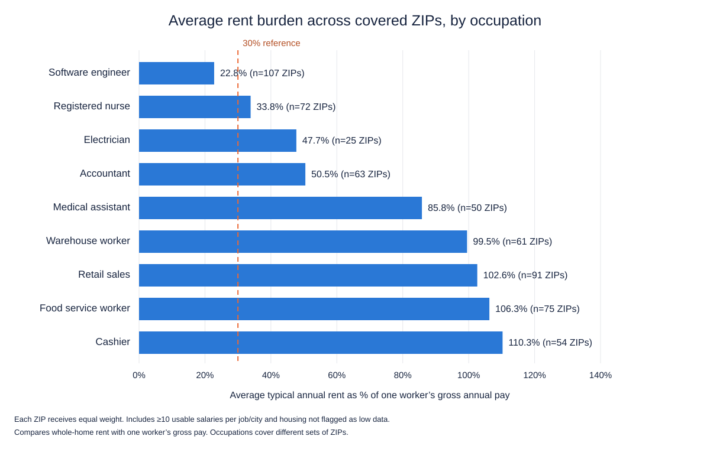

# Wages and Housing Affordability: Tim (Person 2)

**Datathon for Social Good 2026 · Bay Area Affordability Project**

This part of the project estimates what common Bay Area jobs pay, measures historical wage growth, and compares annual pay with the cost of renting or buying a typical home.

**Main outputs for the team:** `outputs/wages_by_job_city.csv` and `outputs/burden_by_job_zip.csv`.

---

## Key findings

1. **Typical rent can exceed a worker’s entire gross salary.** The Belmont cashier estimate implies spending **114.8% of annual pay** renting a typical home. This estimate has fewer than 10 usable salaries and is illustrative rather than a headline finding.
2. **Higher pay does not necessarily make buying affordable.** In Burlingame, the software-engineer estimate puts rent at **22.6% of gross pay**, but buying requires approximately **3.43 times that salary** under the mortgage assumptions.
3. **Historical wage growth differs across occupations and nearby metros.** Average annual wage growth was approximately **4.35% for software developers** and **4.54% for registered nurses** in the San Francisco metro, compared with **6.76%** and **8.06%**, respectively, in the San Jose metro. These estimates use the retained annual comparisons and describe occupation-level wage changes, not individual raises. Metro-boundary verification remains pending.
4. **Rent affordability differs sharply by occupation within the same ZIP.** In Burlingame ZIP 94010, typical monthly rent is approximately **$4,144**. That represents **22.6% of estimated software-engineer pay**, compared with **106.8% of warehouse-worker pay**. The warehouse estimate is flagged as thin data, so this comparison is illustrative.
5. **Some estimates are supported by substantially more salary information than others.** Oakland’s accountant estimate uses **10 usable salaries from 13 postings**, with median annual advertised pay of **$106,454**. Several smaller-city accountant estimates rely on only one or two salaries, making their medians more sensitive to individual postings.
6. **High rent burdens persist among estimates with stronger data support.** Of 598 job/ZIP combinations with usable rent estimates that meet the data-quality thresholds, **474 (79.3%)** require more than 30% of gross annual pay for rent. **154 (25.8%)** require more than the worker’s entire annual salary.
7. **Cashiers face consistently high rent burdens across the supported ZIP estimates.** Among the 54 cashier/ZIP combinations meeting the data-quality thresholds with available rent, even the lowest rent burden is **69.3% of gross annual pay**. The median is **107.8%**.

These results compare advertised pay with typical housing costs. They do not measure what individual households actually earn or spend.

---

## Average rent burden by occupation

This table includes job/ZIP combinations with at least **10 usable salaries per job/city** and housing **not flagged as low data**.

| Occupation | ZIPs analyzed | Average rent burden |
|---|---:|---:|
| Software engineer | 107 | 22.8% |
| Registered nurse | 72 | 33.8% |
| Electrician | 25 | 47.7% |
| Accountant | 63 | 50.5% |
| Medical assistant | 50 | 85.8% |
| Warehouse worker | 61 | 99.5% |
| Retail sales | 91 | 102.6% |
| Food service worker | 75 | 106.3% |
| Cashier | 54 | 110.3% |

Each value averages ZIP-level rent burdens, comparing typical whole-home rent with one worker’s gross annual pay. Each ZIP receives equal weight; occupations cover different sets of ZIPs. City-level wages are reused across ZIPs.

Childcare workers, home health aides, and K–12 teachers are omitted because no job/ZIP combinations met both data-quality thresholds with usable rent estimates.

These are averages within occupations. The **73.6% overall median** is a separate statistic across all 598 included job/ZIP combinations.

---

## What I did

| Step | What it does |
|---|---|
| 1. Inspect the sample | Loaded the 1,000-posting Indeed sample and examined salary formats, locations, and missing values. |
| 2. Process the full dataset | Read the approximately 2 GB Indeed file in 100,000-row chunks, retaining featured jobs. |
| 3. Remove duplicates | Removed duplicate combinations of job title, company name, and location. |
| 4. Identify cities | Extracted California cities from location strings, including full street addresses. |
| 5. Filter geography | Matched extracted cities and communities to the nine Bay Area counties. |
| 6. Group jobs | Used documented title keyword rules to assign postings to 12 featured jobs. |
| 7. Hand-check | Reviewed 20 sampled titles per job and excluded incorrect matches. |
| 8. Clean salaries | Converted supported salary formats to annual equivalents and tracked missing pay. |
| 9. Summarize wages | Calculated median annual pay, posting counts, usable-pay counts, and missing-pay share by job and city. |
| 10. Add BLS history | Extracted occupation wages from five metro areas for May 2021–2025. |
| 11. Project pay | Applied historical average wage growth to current Indeed median pay. |
| 12. Join housing | Joined ZIP-level housing estimates to city-level wages using normalized city names. |
| 13. Calculate affordability | Calculated rent burden and ownership gap for available job/ZIP combinations. |
| 14. Create a figure | Plotted average rent burden across covered ZIPs for each occupation meeting salary and housing data-quality thresholds. |

The full-file job filter produced **15,223 postings after deduplication**. The initial Bay Area filter retained **6,162**. Manual-review exclusion rules reduced this to **6,019**, before narrowing the teacher category to K–12.

### Featured jobs

| Job group | Examples or scope |
|---|---|
| Cashier | Cashier and related front-end roles |
| Retail sales | Retail sales associate roles |
| Food service worker | Food service workers, baristas, restaurant servers, and hosts |
| Home health aide | Home health and personal care aides |
| Childcare worker | Childcare and nanny roles; pet daycare excluded |
| Warehouse worker | Warehouse and material-handling roles; management excluded |
| Medical assistant | Medical assistant roles |
| K–12 teacher | Explicitly identified K–12 classroom roles |
| Registered nurse | RN roles; identified management and advanced-practice roles excluded |
| Electrician | Electrician roles |
| Accountant | Accountant roles across experience levels |
| Software engineer | Software engineer and developer roles; internships excluded |

### How annual pay works

Salary ranges use their midpoint.

| Pay unit | Annual conversion |
|---|---|
| Hourly | Pay × 2,080 |
| Weekly | Pay × 52 |
| Monthly | Pay × 12 |
| Annual | Use directly |

One-sided offers such as “From $19 an hour” are excluded from pay medians because they provide a bound rather than a complete estimate.

### How wage growth works

1. Compare BLS annual median wages within each metro and occupation.
2. Calculate each valid consecutive-year percentage change.
3. Average the available changes, requiring at least two.
4. Apply that growth rate to the Indeed median pay.

**Projected pay = median annual pay × (1 + average annual wage growth).**

Food service, warehouse work, and K–12 teaching span multiple BLS occupations. Their growth estimates use equal weights across the mapped occupations. If a required occupation lacks usable growth, the combined estimate remains blank.

### How rent burden works

**Rent burden = 12 × typical monthly rent ÷ median annual pay.**

A value of **0.40** means rent consumes **40% of gross annual pay**. Values above 1.0 are kept.

### How ownership gap works

1. Finance 80% of the typical home value, assuming 20% down.
2. Calculate principal-and-interest payments for a 30-year fixed mortgage.
3. Divide annual payments by 0.30 to estimate required gross income.
4. Divide required income by the job’s median annual pay.

**Ownership gap = required annual income ÷ median annual pay.**

A value of **2.0** means buying requires twice the estimated job salary.

The calculation uses a **7.11% annual interest rate**, reported by the participant as Freddie Mac’s November 12, 2026 rate. 

---

## Data decisions

- **Annualization is a full-time equivalent.** Hourly wages assume 2,080 hours annually; weekly wages assume 52 weeks.
- **Implausible salaries are excluded.** Annualized values below $15,000 or above $1,000,000 are not used.
- **Suspicious units are not guessed.** Incorrect-looking salary amounts or units remain missing.
- **Daily pay is excluded.** Annual working days are unknown.
- **Tips are excluded.**
- **Missing and unusable pay are different.** `share_missing_pay` measures absent salary text, not every unsuccessful conversion.
- **Postings without usable pay remain in posting counts.**
- **Thin data is flagged.** `thin_data` means fewer than 10 postings; `thin_pay_data` means fewer than 10 usable salaries.
- **K–12 teachers require explicit school-level evidence.** Preschool, assistants, substitutes, tutoring, after-school, and identified special-education roles are excluded.
- **Seven housing rows were excluded** because of out-of-area or unverified ZIP mappings, leaving 286 housing ZIP rows.
- **Growth projections are scenarios**, not validated forecasting-model predictions.

---

## Potential biases

- **Advertised pay is not actual earnings.** The sample reflects available postings rather than all employed workers.
- **Annualization assumes consistent work.** It can overstate earnings for part-time, seasonal, travel, or school-year work.
- **Seniority varies.** Job groups can mix entry-level and experienced workers.
- **City wages are applied across ZIPs.** The method does not measure ZIP-specific wages or commuting patterns.
- **Missing pay may be selective.** Employers disclosing salaries may differ from those that do not.
- **Housing costs are not household-specific.** Roommates, multiple earners, household size, and housing size affect affordability.
- **Ownership costs are incomplete.** Taxes, insurance, HOA fees, maintenance, closing costs, and the ability to save a down payment are excluded.
- **BLS changes are not individual raises.** They may reflect workforce composition and estimation changes.
- **Keyword matching is approximate.** Reviewing matches identifies false positives but does not measure missed jobs.
- **ZIP geography is imperfect.** ZIP reference checks do not replace address-level boundary validation.

---

## Files 

| File | What it is |
|---|---|
| `outputs/wages_by_job_city.csv` | Current pay, posting counts, missing-pay share, growth, projections, and quality flags |
| `outputs/burden_by_job_zip.csv` | Required rent-burden and ownership-gap measures by job and ZIP |
| `outputs/burden_by_job_zip_details.csv` | Supporting housing, salary, mortgage calculations, and quality flags |
| `outputs/figures/average_rent_burden_by_job.svg` | Average rent burden by occupation, using estimates meeting data-quality thresholds |
| `notebooks/wages_and_affordability.ipynb` | Cleaning, wage-growth, housing-affordability, and export workflow |

### Wage and burden columns

| Column | Meaning |
|---|---|
| `job` | Featured occupation group |
| `city` | City associated with the postings |
| `median_pay` | Median usable annualized advertised pay, USD |
| `n_postings` | Number of retained postings |
| `n_usable_pay` | Number contributing to the pay median |
| `share_missing_pay` | Fraction without salary text |
| `wage_growth` | Historical average annual growth as a decimal |
| `projected_pay` | One-year pay scenario, USD |
| `zipcode` | Five-digit ZIP. Read as text. |
| `rent_burden` | Annual typical rent divided by annual pay |
| `ownership_gap` | Required buying income divided by annual pay |
| `thin_data` | Fewer than 10 postings |
| `thin_pay_data` | Fewer than 10 usable salaries |

### Average rent burden by occupation figure

The figure shows **average rent burden across covered ZIPs for nine occupations**. It includes at least **10 usable salaries per job/city** and housing not flagged as low data. K–12 teachers, home health aides, and childcare workers have no usable rent estimates meeting these thresholds and are omitted.

| Element | How to read it |
|---|---|
| Horizontal bars | Average ZIP-level annual rent burden for each occupation |
| Bar labels | Average percentage and number of covered ZIPs |
| Dashed line | 30% reference |
| Values above 100% | Average rent burden exceeds one worker’s gross annual pay |

Each ZIP receives equal weight. The averages range from **22.8% for software engineers** to **110.3% for cashiers**.

The figure compares typical whole-home rent with one worker’s gross annual pay. It does not measure actual household spending or account for roommates, multiple earners, taxes, or differences in housing size. City-level wages are reused across ZIPs.

Occupations cover different sets of ZIPs, so differences reflect both pay and geographic coverage. This figure summarizes averages rather than selecting the highest-burden examples.

---

## Sources

- Indeed job-listings dataset supplied for the datathon.
- [BLS OEWS tables](https://www.bls.gov/oes/tables.htm), May 2021–2025 metropolitan releases.
- Person 1’s `albert_housing_by_zip.csv`.
- [Freddie Mac PMMS](https://www.freddiemac.com/pmms), rate supplied by the participant and pending independent verification.
- [GeoNames postal data](https://download.geonames.org/export/zip/) and [free ZIP reference data](https://github.com/midwire/free_zipcode_data) for housing geography checks.
